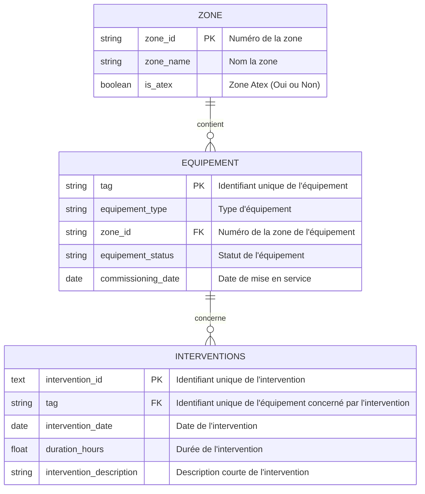

# SQLdemo

## Introduction
SQLdemo is a demonstration project showcasing the possibilities offered by an SQL database in a fictional industrial context.
This project also allows me to consolidate my SQL knowledge.

## Project structure

The project uses fictitious data from a fictitious industrial site.

We imagine equipment distributed across various areas of the industrial site, along with a record of maintenance interventions on different assets.

Each intervention has a unique identifier, and each piece of equipment has its own unique tag.

**Note**
Since the interventions are fictitious, their descriptions may not be consistent with the type of equipment involved. This data is intended to demonstrate what can be done, rather than provide a 100% accurate representation of an industrial site.

Relational database schema

## Datasets
The datasets were created as CSV files to add another layer to the database creation process.
We assume that the data must exist somewhere in Excel files. This also demonstrates that data can be imported from a spreadsheet into a relational database to build the database and run initial queries.

## How to ?

### Instruction
PostgreSQL est utilisé ici
Dbeaver crée la database avec le script 01_schema.sql
On vient injecter les données grace aux .csv depuis dbeaver
On commence par Zone, Puis Equipement et enfin Interventions (pour éviter des erreurs par exemple insérer un équipement dans une zone qui n'existe pas encore)

On peut ensuite executer les différentes requêtes SQL

## AI usage
AI was used as a support tool in the following cases:
- translation
- review
- Generate fictitious datasets
