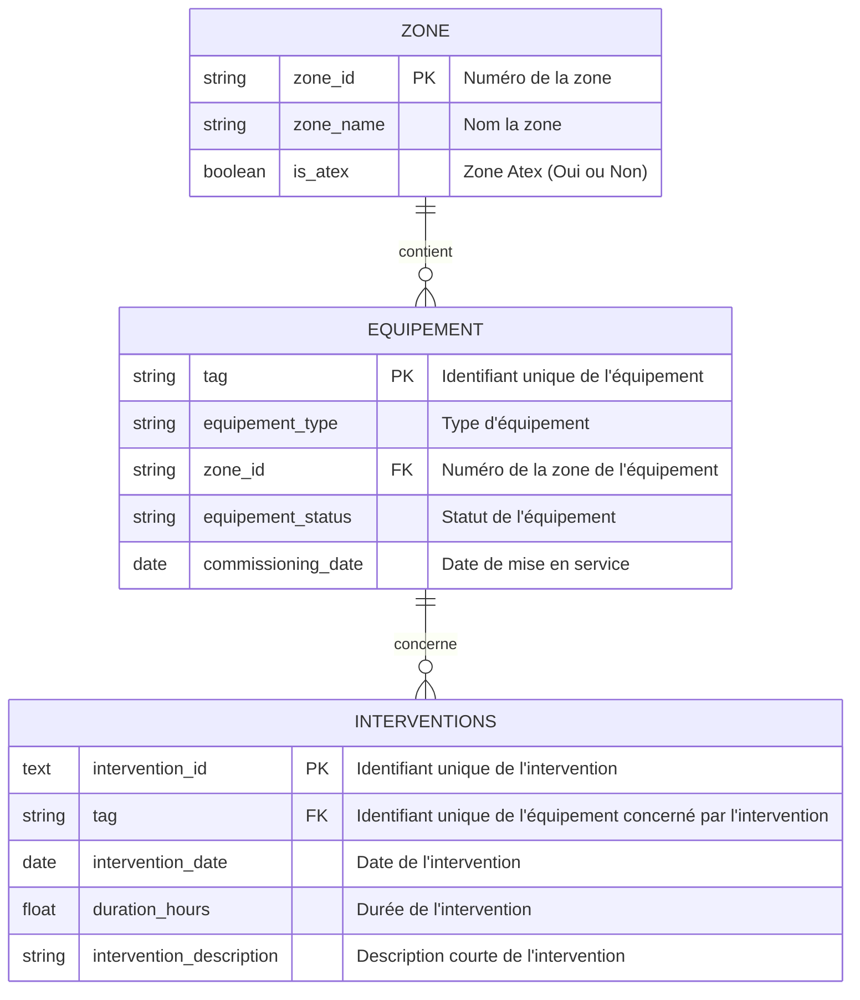

# SQLdemo

## Introduction

SQLdemo is a demonstration project created to explore what an SQL database can do with fictional industrial data.

I have an industrial design background and a web development degree. This combination gives me a dual perspective: I understand technical equipment and industrial environments, while also being able to structure information, use databases, and develop digital solutions.

This project brings together that industrial and technical knowledge. It demonstrates how relational data about equipment and maintenance interventions can be imported from CSV files, organized in PostgreSQL, and analyzed through SQL queries.

It is intended as a practical learning and presentation project, rather than a production-ready industrial system.

## What this project demonstrates
- Data modeling with a relational database
- CSV data import
- SQL queries and table joins
- Filtering and aggregation
- Communication of technical results to non-technical users

## Project structure

The project uses fictitious data from a fictitious industrial site.

We imagine equipment distributed across various areas of the industrial site, along with a record of maintenance interventions on different assets.

Each intervention has a unique identifier, and each piece of equipment has its own unique tag.

**Note**
Since the interventions are fictitious, their descriptions may not be consistent with the type of equipment involved. This data is intended to demonstrate what can be done, rather than provide a 100% accurate representation of an industrial site.

Relational database schema


### Example of data
Find below the first line of each table

#### Equipement table
| tag | equipement_type | zone_id | equipement_status | commissioning_date |
|---|---|---|---|---|
| A0001V | Vanne | A | marche | 1982-04-17 |
| B0002R | Robinet | B | arrêt | 1996-11-03 |
| C0003C | Clapet | C | panne | 2008-06-21 |
| D0004F | Filtre | D | marche | 1991-02-14 |
| E0005E | Echangeur | Z1 | arrêt | 2015-09-08 |
| F0006C | Condenseur | Z2 | marche | 1987-12-26 |
| G0007P | Pompe | A | panne | 2001-03-19 |
| H0008T | Turbine | B | marche | 2019-07-02 |
| J0009M | Moteur | C | arrêt | 1993-10-11 |

#### Intervention table
| intervention_id | tag | intervention_date | duration_hours | intervention_description |
|---|---|---|---|---|
| INT001 | A0001V | 2022-01-14 | 1.5 | Inspection visuelle de la vanne |
| INT002 | B0002R | 2022-02-03 | 2 | Remplacement du joint d'étanchéité |
| INT003 | C0003C | 2022-02-18 | 3.5 | Nettoyage et contrôle du clapet |
| INT004 | D0004F | 2022-03-07 | 2.5 | Remplacement de l'élément filtrant |
| INT005 | E0005E | 2022-03-22 | 5 | Contrôle des échangeurs et nettoyage externe |
| INT006 | F0006C | 2022-04-11 | 4 | Inspection du condenseur |
| INT007 | G0007P | 2022-04-26 | 3 | Remplacement d'un roulement de pompe |
| INT008 | H0008T | 2022-05-09 | 6.5 | Contrôle des vibrations |
| INT009 | J0009M | 2022-05-24 | 2 | Contrôle électrique du moteur |

#### Zone table
| zone_id | zone_name | is_atex |
|---|---|---|
| A | Bâtiment Production | true |
| B | Bâtiment R&D | true |
| C | Entrepôt matières premières | false |
| D | Atelier de maintenance | false |
| Z1 | Quai 1 | false |
| Z2 | Quai 2 |  |

## Datasets
The datasets were created as CSV files to add another layer to the database creation process.
We assume that the data must exist somewhere in Excel files. This also demonstrates that data can be imported from a spreadsheet into a relational database to build the database and run initial queries.

## How it work ?
This project uses PostgreSQL and DBeaver for database management.
The *01_schema.sql* script is executed in DBeaver to create the database and tables according to the relational database schema.
[View the SQL script](sql/01_schema.sql)


The data is then imported from the CSV files into DBeaver in the following order: Zones, Equipment, and finally Interventions. This sequence is important because the equipment records depend on existing zones, and the intervention records depend on the other tables.

Once the data has been imported, the SQL queries can be executed.

## Examples of use
SQL queries can be used to list and filter the contents of each table. However, the most interesting analyses come from combining data from two or more tables.

The following sections provide examples of SQL queries along with their initial results. Each query is saved in a SQL file, which is identified in the corresponding example.

Note: For presentation purposes, if a query returns many results, only the first 10 are shown in the examples below.

**List the equipment from oldest commissioning date to most recent**
[View the SQL script](sql/02_oldest_equipment.sql)
```sql
SELECT * FROM equipement
ORDER BY commissioning_date ASC;
```

**Result**

| tag | equipement_type | zone_id | equipement_status | commissioning_date |
|---|---|---|---|---|
| L0011V | Vanne | Z1 | marche | 1980-08-06 |
| R0064F | Filtre | D | marche | 1980-12-12 |
| K0082R | Robinet | D | marche | 1981-04-29 |
| P0038T | Turbine | B | panne | 1981-06-03 |
| Y0095E | Echangeur | Z1 | panne | 1982-02-13 |
| A0001V | Vanne | A | marche | 1982-04-17 |
| G0055E | Echangeur | A | panne | 1982-09-30 |
| A0073C | Clapet | A | panne | 1983-08-27 |
| E0029M | Moteur | Z1 | arrêt | 1983-11-14 |
| C0051V | Vanne | C | arrêt | 1984-01-08 |
---

**List all valves in Building A**
[View the SQL script](sql/03_valves_in_building_A.sql)
```sql
SELECT * FROM equipement
WHERE equipement_type = 'Vanne'
AND zone_id = 'A';
```
**Result**

| tag | equipement_type | zone_id | equipement_status | commissioning_date |
|---|---|---|---|---|
| A0001V | Vanne | A | marche | 1982-04-17 |
| G0031V | Vanne | A | arrêt | 1992-03-25 |
| N0061V | Vanne | A | marche | 2003-07-17 |
| U0091V | Vanne | A | marche | 2001-05-15 |

---
**Count the interventions carried out in 2022, the total hours spent, and the average time per intervention**
[View the SQL script](sql/04_2022_interventions_stats.sql)
```sql
SELECT 
    COUNT(intervention_id) AS nbr_inter,
    SUM(duration_hours) AS Temps_inter_cumul,
    ROUND(AVG(duration_hours), 2) AS temps_moyen
FROM interventions
WHERE intervention_date BETWEEN '2022-01-01' AND '2022-12-31';
```
**Result**

| nbr_inter | temps_inter_cumul | temps_moyen |
|---:|---:|---:|
| 23 | 78.00 | 3.39 |

---
**List the equipment located in ATEX zones**
[View the SQL script](sql/05_equipment_in_atex_zone.sql)

```sql
SELECT tag, equipement_type FROM equipement
LEFT JOIN "zone" z  ON equipement.zone_id  = z.zone_id
WHERE is_atex = true
ORDER BY tag ASC;
```
**Result**

| tag | equipement_type |
|---|---|
| A0001V | Vanne |
| A0025E | Echangeur |
| A0049M | Moteur |
| A0073C | Clapet |
| A0097P | Pompe |
| B0002R | Robinet |
| B0026C | Condenseur |
| B0050C | Compresseur |
| B0074F | Filtre |
| B0098T | Turbine |
| G0007P | Pompe |
| G0031V | Vanne |
| G0055E | Echangeur |

---
**Show the 10 equipment items with the most interventions and their cumulative hours. Sort by the number of interventions in descending order, then by cumulative hours in descending order in case of a tie**
[View the SQL script](sql/06_top_10_equipment.sql)

```sql
SELECT equipement.tag,
       equipement.equipement_type,
       COUNT(interventions.tag) AS nombre_intervention,
       SUM(interventions.duration_hours) AS heure_cumul
       FROM equipement
LEFT JOIN interventions ON equipement.tag = interventions.tag
GROUP BY equipement.tag
ORDER BY nombre_intervention DESC, heure_cumul DESC
LIMIT 10;
```
**Result**

| tag | equipement_type | nombre_intervention | heure_cumul |
|---|---|---:|---:|
| G0007P | Pompe | 3 | 13.00 |
| A0001V | Vanne | 3 | 6.00 |
| T0018T | Turbine | 2 | 14.00 |
| V0020C | Compresseur | 2 | 13.50 |
| K0010C | Compresseur | 2 | 11.50 |
| E0005E | Echangeur | 2 | 11.00 |
| Q0015E | Echangeur | 2 | 9.50 |
| R0016C | Condenseur | 2 | 9.50 |
| H0008T | Turbine | 2 | 9.00 |
| Z0024F | Filtre | 2 | 7.50 |


## Possible future improvements

This project is intended as a learning exercise: the data is fictional, and the data model has deliberately been kept simple. In a real-world industrial context, the information and business rules would first need to be validated with the relevant teams. Existing data would then need to be consolidated, with quality checks for required fields, permitted values, consistent dates, and valid relationships between tables.

The model could subsequently be extended to include detailed maintenance tracking, associated documents, and additional technical data. A strict access-control strategy, update procedures, regular backups, and appropriate data-consultation tools would also need to be implemented.


## AI usage
AI was used as a support tool in the following cases:
- Translation
- Code Review
- Generate fictitious datasets
